# Durable Pi: The Durable Agent Network

> **This repo is a clone of [disler/durable-pi](https://github.com/disler/durable-pi) by IndyDevDan, with durability updates.** The original is explained in Dan's video, **[Pi Durable PROACTIVE Agents](https://youtu.be/DNDYYHsypZg)**. This version adds a crash-test harness and changes for 11 durability gaps. See [What this version adds](#what-this-version-adds). The rest of this README is the original text.

> **Proactive agents start working before you sit down. They don't wait for you to work. They work for you, then wait.**
> Durable pi agents on any machine you own, driven from a web UI, a terminal or one curl.

📺 Watch this video to get the full breakdown of this codebase: **[Pi Durable PROACTIVE Agents](https://youtu.be/DNDYYHsypZg)**

<p align="center">
  
</p>

[Pi Durable](https://earendil.com/posts/pi-durable/), from the team behind the [Pi coding agent](https://github.com/earendil-works/pi), persists ongoing work, conversations and application state through failures, through clients and through change itself. This repo puts it to work. Every device runs a small server, `dpi-backend`, that owns its agents, their SQLite databases and their tools. Clients connect with a **URL and a bearer token**: a web hub that watches every device at once, `dpi-tui` in the terminal, or one `curl` that sends work and waits for the answer. **The agent lives on the device, not in the client.** Close the browser, quit the terminal or restart the machine mid-tool, and the run picks up from its last checkpoint.

---

## What this version adds

The original repo already makes agent runs durable: a run survives a client disconnect and a device restart. This version tests that claim by killing the backend in the middle of a tool call. It also closes or narrows 11 of the gaps that a read of the code and the pi-durable docs found. Each gap is a place where durability stops at a boundary, or where state survives but nothing resumes it or reports it.

### Live docs (GitHub Pages)

| Page | What it covers |
|---|---|
| [Durable Pi Explained](https://az9713.github.io/durable-pi-reinforced/docs/index.html) | How the original repo works, sections 0 to 15, with the durability gaps in section 14 |
| [Durability fix plan](https://az9713.github.io/durable-pi-reinforced/docs/durability-fixes.html) | The 11 changes: why each one is necessary, what breaks without it, the options and the decisions |
| [Changes as built](https://az9713.github.io/durable-pi-reinforced/docs/implemented-changes.html) | What each change does, where it is (`file:line`), why it exists, what checks it, and its limit |

### The changes

| # | Change | Where |
|---|---|---|
| C1 | Crash-test harness: 8 cases that SIGKILL the backend during a tool call or a job step, restart it, and check the effect | `apps/dpi-backend/tests/crash.test.ts`, `src/faux.ts` |
| C2 | `once()`: runs one outside call at most once per tool task, with an idempotency key. No tool uses it yet | `src/extensions.ts` |
| C3 | Job steps store their values, so a phase resumed after a crash does not run finished steps again | `src/jobs.ts` |
| C4 | The proactive demo sends log rows that failed to reach Jev again, at most once a minute, inside the backlog window | `proactive-dpi-be/src/watcher.ts`, `watch-store.ts` |
| C5 + C11 | `GET /v1/sessions/:s/stuck`: lists queued follow-ups that nothing will run, and tasks that no definition can run. Reports only | `src/store.ts`, `src/routes.ts` |
| C6 | The backend starts when some curated models are missing from the catalog, or when the live model list fails | `src/store.ts` |
| C7 | Lock files hold a boot id, so a lock from before a reboot is stale (Linux and WSL2; macOS keeps the PID check) | `src/store.ts` |
| C8 | A log line for each `bash` command that the Jev guard let run without a verdict | `src/addons.ts` |
| C9 | `POST /v1/sessions/:s/backup`: copies an idle session's database to `DPI_BACKUP_DIR` | `src/store.ts`, `src/routes.ts` |
| C10 | A README row for automatic restart on Windows through WSL2 (docs only) | `apps/dpi-backend/README.md` |

Paths starting with `src/` are in `apps/dpi-backend/`.

### What was checked, and what was not

- `tsc --noEmit` is clean for `dpi-backend` and `proactive-dpi-be`.
- `npm test` in `apps/dpi-backend` passes 18 of 18 (the original 10, plus the 8 crash cases), with Node 22.22.1 in WSL2.
- C3, C4, C6 and C10 were not tested at run time. The reasons are on the [Changes as built](https://az9713.github.io/durable-pi-reinforced/docs/implemented-changes.html#untested) page.
- The original checks in [What has been checked](#what-has-been-checked) were not run again for this version.

Two findings from the crash tests:

1. The built-in `bash` tool is `unsafe` (in pi-durable 1.0.3). A `bash` call cut off by a restart comes back `interrupted` and does not run again, as the original README says.
2. The `bash` child process survives a SIGKILL of the backend and finishes its command. Nothing reports that effect.

These changes do not make the repo exactly-once. The limits in [Where it can still fail](#where-it-can-still-fail) still apply.

---

## Install

### Agentic Install

Open the repository in Claude Code (or Pi, or your favorite agentic coding tool) and run:

```text
/install
```

The command lives in [`.claude/commands/install.md`](.claude/commands/install.md). It checks Node 24, npm, just and zsh, confirms `OPENROUTER_API_KEY` in `.env` without printing it, runs `just install`, writes this machine's device config with `just net up local`, builds the web UI, offers to set up the proactive demo and finishes with `just check`. It never starts a server and never touches a device other than `local`. Run `/prime` afterwards to load the project context into your agent.

### Manual Install

**Prereqs:** [Node.js 24](https://nodejs.org) (via [nvm](https://github.com/nvm-sh/nvm)), [`just`](https://github.com/casey/just), `zsh` (macOS ships it), an [OpenRouter](https://openrouter.ai) API key. Remote devices need passwordless `ssh`, and exe.dev VMs need an [exe.dev](https://exe.dev) account.

```bash
cp .env.example .env                           # set OPENROUTER_API_KEY; copied into each device's backend.env, never sent to clients
cp dpi-network.example.yaml dpi-network.yaml   # your devices; starts with only `local`
just install                                   # npm install for dpi-sdk, dpi-backend, dpi-playground and dpi-tui
just net up local                              # write ~/.dpi/backend.env with a fresh token and register this machine
just hub build                                 # build the web UI the hub serves (once, and after UI changes)
just backend run                               # this machine's device server on :4780
just hub start                                 # web UI on http://localhost:4781 (second terminal)
just tui attach local                          # or attach from the terminal (third terminal)
```

The proactive demo has its own dependencies: `just proactive install`, `just proactive build`, then `just proactive take`.

---

## What is a durable agent?

<p align="center">
  
</p>

Can't you just `/resume`? Resume restores a chat transcript. It does not know which tool call was running when the process died, what that call already changed, what input was queued behind it, or what your application believed was true. A durable agent commits all of it (history, queued input, task checkpoints and application state) to storage **before** anything is shown. Reopen the storage and the harness knows exactly where every piece of work stopped.

<p align="center">
  
</p>

Replay-safe tools rerun after a crash. A tool that may have partially run, like a `bash` call cut off by a restart, comes back as an interrupted result, so the agent decides what happens next instead of silently repeating a side effect. Once a run survives its own process, it no longer needs the window that started it. So the agent moves to the device, and every interface becomes a thin client of one HTTP API. **The device owns the run. Clients only watch and steer.**

---

## The hook: a proactive durable agent

<p align="center">
  
</p>

A durable agent doesn't have to wait for your prompt. [`apps/proactive-dpi-demo`](apps/proactive-dpi-demo) watches a mock production log stream: Google Cloud Run entries for an online store. When guest checkouts start failing, code opens an incident and starts a durable agent on its own. By the time you show up, the agent has sized the impact from the logs, found the commit that broke checkout, written the fix and a regression test, and proved the test fails on `main` and passes on its branch. **Then it waits for you to approve the deploy.** It doesn't wait for you to work. It works for you, then waits.

<p align="center">
  
</p>

[Jev](https://typesafe.ai) judges every log row, and each layer does the one job it is best at:

| Layer | Decides | In the demo |
|---|---|---|
| **Code** | thresholds and side effects | 3 incident verdicts with one fingerprint within 120 s open an incident |
| **Jev** | bounded judgments, one call per row | `normal`, `suspicious` or `incident` plus an impact score, in a few hundred milliseconds for about $0.00003 a row |
| **Agent** | open-ended work | investigate, fix, prove, deploy: about $0.09 per incident with Sonnet 5.5 |

<p align="center">
  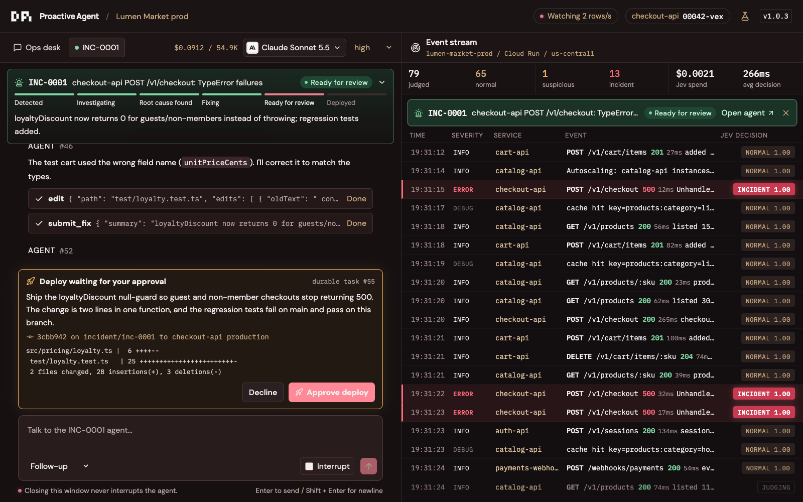
</p>

You stay near the loop. The deploy is a durable task owned by the agent's tool call:

- **Decline or interrupt it**, and nothing ships.
- **Question it.** Ask the agent about the change before you decide.
- **Approve it.** A new checkout-api revision built from the agent's commit rolls out and is verified on live checkouts.
- **Restart through it.** Kill the backend while the deploy waits. After the restart, the same task is still waiting and nothing runs twice.

```bash
just proactive take   # fresh take: prints the URL; the bug deploys at 5 s and the agent asks to deploy at about 30 s
just proactive bug    # deploy the bad commit now instead
just proactive stop   # end the demo
```

The playbook, tools, hooks, Jev questions, thresholds and model are all yours to change. The timeline, flags and recovery checks are in [`apps/proactive-dpi-demo/README.md`](apps/proactive-dpi-demo/README.md).

---

## The Durable Agent Network

<p align="center">
  
</p>

| Piece | Where it runs | Owns |
|---|---|---|
| **`dpi-backend`** | every device, port 4780; a launchd or systemd service on remote machines | the harnesses, `~/.dpi/backend/catalog.sqlite`, one `sessions/<id>/agent.sqlite` per session, the device's shared App State, the bearer token in `~/.dpi/backend.env` |
| **hub** (`apps/dpi-playground`) | your laptop, `127.0.0.1:4781` | the device registry and tokens in `~/.dpi/network.sqlite`, a token-injecting REST proxy, one multiplexed SSE stream per browser tab, the Vue client |
| **`dpi-tui`** | any terminal | nothing: it reads a device's URL and token from the registry and talks to the device directly |
| **`dpi-sdk`** | inside all of the above | the v1 wire contract, `DpiClient`, the SSE reader, the `AgentModel` and `SessionModel` reducers, transcript items, the registry and the ops drivers. See [`apps/dpi-sdk/README.md`](apps/dpi-sdk/README.md) |

<p align="center">
  
</p>

The network has three levels. A **device** runs one `dpi-backend`. A **session** is one pi-durable harness and one database in a working directory on that device. An **agent** is a conversation in that session: `Main`, a fork or a subagent. The [v1 API](apps/dpi-backend/API.md) lives at the device's URL and addresses sessions and agents by id or name (`/v1/sessions/release-notes/agents/main`). It streams the device, a session or an agent as `hello → snapshot → deltas`, and makes every send idempotent through a `requestId`. Streams never replay: a reconnect starts from a fresh snapshot, which is why a killed client loses nothing. The web client and the TUI feed the same frames into the same `AgentModel` and render the same transcript items. **One reducer, two renderers.**

---

## What a durable agent can do

Every capability below is in the web client's inspector and in the [v1 API](apps/dpi-backend/API.md), and the agent can use most of them as tools. Every change applies from the agent's next request, and nothing restarts.

### Compaction in the background

<p align="center">
  
</p>

The context bar marks where automatic compaction starts and where it blocks: a background summary at 200k tokens and a blocking one at 250k by default (smaller model windows fall back to pi-durable's margins), adjustable per session. The summary is written in the background while the agent keeps working. The stored history keeps every entry, and the agent's `search_history` tool pages through all of it, including what came before a compaction or a reset.

### One shared App State

<p align="center">
  
</p>

Every agent and session on a device shares one JSON document through the `read_state` and `update_state` tools. Each `update_state` call is one atomic path operation (create, update, delete or increment), so agents never overwrite each other's fields. The State tab renders the document as live controls, and a full-document save from a stale revision gets `409 conflict`. Use it to hand facts between agents, or to debug one issue across many sessions.

### Durable jobs: human near the loop

<p align="center">
  
</p>

A durable job is a repeatable workflow with named phases, and every phase is a checkpoint, so a restart resumes the current phase. Run one from the Tasks tab, or let the agent call `run_durable_job` and follow it with `check_durable_job`. Three ship as examples: `workspace-snapshot`, `change-watch` and `release-check`, where a subagent gathers the evidence and the job waits for a person before it publishes. You are not stuck in the loop and not out of it. **You are near the loop**, and you step in when a job asks for you.

### Change the tools mid-run

<p align="center">
  
</p>

Every model call and every tool call is its own durable task, so the agent's tool set can change between requests. The Tools tab lists each tool with its signature and replay policy. Flip **Read only** and the 8 tools that write (`bash`, `write`, `edit`, `update_state` and the rest) leave the agent's next request, leaving the 6 that only read. Model and thinking level change the same way, and so do instructions through the API.

### Extensions

<p align="center">
  
</p>

pi-durable extensions bring your own tools, hooks, prompt sections and checkpointed tasks. The Extend tab turns two custom extensions on or off per agent. `system-prompts` is a checklist of built-in prompts, led by [`smart_ass_opus_fix.md`](apps/dpi-backend/prompts/smart_ass_opus_fix.md). `jev-damage-control` (off by default) sends every `bash` command to the Jev API before it runs and blocks destructive or irreversible ones in about 300 ms. Its verdict is a durable memo, so a restart never asks twice. If Jev is unreachable, the command runs.

### Fork at any entry

<p align="center">
  
</p>

Fork any agent at any entry, from the transcript or with `/fork`. The fork copies the conversation up to that entry and both agents keep going, so you can try another direction without losing the context you built. Forks nest under their parent in the tree.

---

## Any client: web, terminal, curl

<p align="center">
  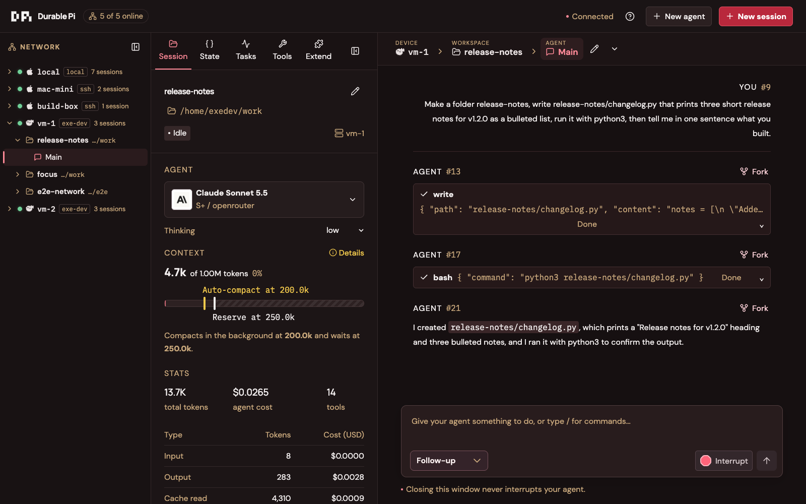
</p>

The web client has three columns: the **network tree** (device → session → agent), the **inspector** and the **agent**. The inspector tabs are Session (model, thinking, context bar, usage), State, Tasks, Tools and Extend. The composer sends a follow-up, a steer (it joins after the current tool round) or a reject-if-busy, and `/` opens the slash commands. The browser never sees a token. It holds one SSE connection to the hub, and the hub opens the authenticated upstreams.

<p align="center">
  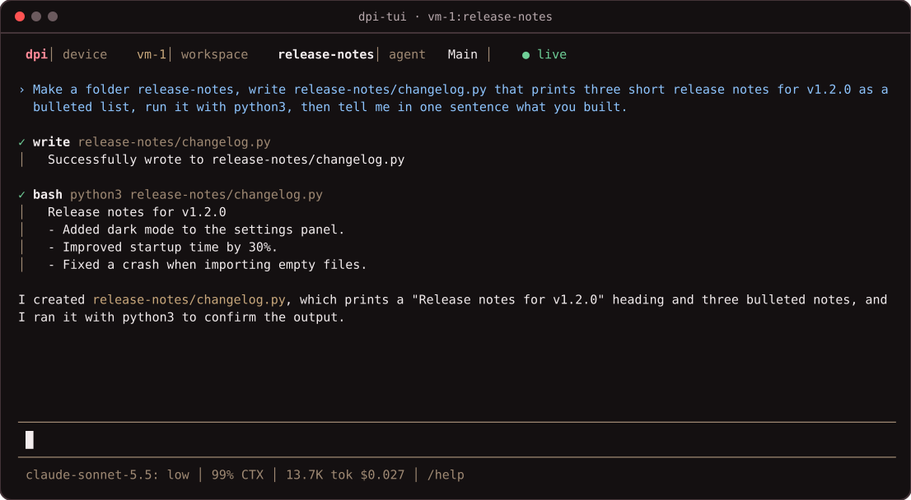
</p>

`dpi-tui` is pi's look and keys over the network API. Enter sends or steers, Alt+Enter queues a follow-up, Esc interrupts, and Ctrl+C on an empty prompt exits with the command to reattach. **The agent keeps running.**

```bash
just tui attach <device>                     # pick or create a session on a device
just tui attach <device>:<session>:<agent>   # straight to an agent, by name or id
just tui new <device> <name>                 # create a session in the device's first start dir and attach
```

Scripts and other agents can skip both clients. One request to an existing session sends the work and returns the answer:

```bash
curl -s "$URL/v1/sessions/oneshot/agents/main/messages" -H "Authorization: Bearer $TOKEN" \
  -H 'content-type: application/json' \
  -d '{"content":"How many files are in this directory? Use bash.","requestId":"oneshot-1","waitMs":120000}'
# {"submissionId":10,"status":"done","answer":{"entryId":17,"text":"The directory is empty. ..."}}
```

The [backend README](apps/dpi-backend/README.md#demo-runbook-hop-into-an-already-running-agent) has the full runbook: start work in the TUI, steer it from the web, close both clients, restart the device mid-tool, and fork the resumed run.

---

## Configure your network

<p align="center">
  
</p>

Devices are data. `dpi-network.yaml` declares each one by kind, and no code or recipe names a machine. It is gitignored; create it from [`dpi-network.example.yaml`](dpi-network.example.yaml), which declares only `local` and has commented `ssh` and `exe-dev` examples. Tokens never live in the YAML: each device generates its own, and `just net register <id>` copies it into the hub registry.

| Kind | How it runs | `just net up <id>` does |
|---|---|---|
| `local` | `just backend run` on this machine, or a service if you set `service:` | env file and registry entry (plus the service when set) |
| `ssh` | a launchd LaunchAgent (macOS) or a systemd unit (Linux) | install Node 24 with nvm, rsync the code and `npm ci`, env, service, register, wait online |
| `exe-dev` | systemd on an [exe.dev](https://exe.dev) VM behind its HTTPS proxy | create the named VM if missing, the `ssh` steps, expose port 4780 over HTTPS before register |
| `url` | anything already running | register the URL and token only |

```bash
just net up <id>         # every step the device's kind supports, in order; idempotent
just net status          # probe every device
just net deploy <id>     # ssh and exe-dev: rsync code, npm ci and restart; data stays
just net logs <id>       # tail the service log
just net restart <id>    # restart the service
just net rotate <id>     # new token on the device, then re-register
just net destroy <id>    # exe-dev only; asks first; refuses VMs not in the YAML
```

Every line of a device's `~/.dpi/backend.env` traces to the YAML: `DPI_PORT`, `DPI_HOST` and `DPI_START_DIRS` from `port`, `host` and `start_dirs`, secrets named in `env_keys` (values read from your `.env`), plain settings from `env`, the device id as `DPI_DEVICE_NAME`, and a `DPI_TOKEN` generated on the first `up`. New sessions start in `start_dirs` (default `~/dpi-work`, created if missing), and any existing folder on the device works as a session's working directory. The hub classifies each device as `online`, `checking`, `offline`, `unauthorized`, `mismatch` (the URL now answers with a different device identity) or `incompatible`. An offline device keeps its last tree, dimmed, with the exact terminal fix for its kind.

---

## Why go durable

<p align="center">
  
</p>

Not every agent needs this. A short, supervised session in one terminal is fine with plain pi. Go durable when the work has to outlive the window you started it in:

| Reason | What it unlocks |
|---|---|
| **Proactive agents** | Agents that start from an event (a log row, a webhook, a schedule) and have the work ready when you arrive |
| **Multi-client agents** | One agent reached from the browser, the terminal, a script or your own product's UI |
| **Multiplayer agents** | Several engineers watch and steer the same agent, like an incident agent during an outage |
| **Long-running agents** | Close the laptop, kill the process or restart the machine, and the run resumes from its last checkpoint |
| **Human near the loop** | Approvals and questions are durable tasks, so an agent can wait hours for a decision |

Start in two places. **Product agents:** a support chatbot on your site should be durable by default, so a customer returns to the same session and you can watch it from any client. **Proactive agents:** put a cheap classifier in front of an event stream and let a durable agent do the first hour of work before anyone opens a laptop. One KPI tells you how far along you are: **how many agents are doing useful work for you right now, without you?**

---

## How it's built

<p align="center">
  
</p>

Each device owns its agents and their data in SQLite. The hub only stores how to reach them, so it can go away at any time.

### Folder structure

```text
durable-pi/
├── dpi-network.example.yaml           # template for dpi-network.yaml (gitignored): devices, kinds, start_dirs
├── .env.example                       # OPENROUTER_API_KEY (+ ELEVENLABS_API_KEY for the demo voice)
├── justfile                           # install, check, and one module per work area
├── just/                              # net, backend, hub, tui, test, proactive (one mod.just each)
├── apps/
│   ├── dpi-sdk/                       # contract, client, reducers, transcript; node/ = registry, YAML config, ops drivers
│   │   └── scripts/net.ts             # the ops CLI behind just net
│   ├── dpi-backend/                   # the device server: REST v1, SSE streams, bearer auth, jobs, extensions
│   │   ├── API.md                     # every route, stream and recipe
│   │   ├── prompts/                   # built-in prompts for the system-prompts extension
│   │   └── deploy/                    # launchd plist, systemd unit, backend.env.example
│   ├── dpi-playground/                # the hub + web client
│   │   ├── apps/dpi-playground-hub/   # YAML seed, device monitor, token proxy, stream mux, guard
│   │   ├── apps/dpi-playground-fe/    # Vue 3: network tree, agent view, inspector tabs
│   │   └── tests/                     # hub test, faux-device UI suite, per-device suites, e2e scenario
│   ├── dpi-tui/                       # pi-like terminal client on @earendil-works/pi-tui
│   └── proactive-dpi-demo/            # the hook: Jev log watcher, incident agents, durable deploy approval
├── images/                            # README diagrams, numbered in reading order
├── .claude/                           # commands/ (prime, install), skills/agent-sandboxes-exe-dev/ (device ops)
└── ai_docs/                           # pi and pi-durable documentation snapshots
```

### Commands

```bash
just                       # command groups: net, backend, hub, tui, test, proactive
just install               # npm install for the four network apps
just check                 # type checks and unit tests, every app (free, no network)
just backend run           # this machine's device server on :4780
just hub start             # web UI on :4781
just tui attach <target>   # <device>[:<session>[:<agent>]]
just net up <id>           # bring a device online (idempotent)
just test ui               # web UI suite against two faux devices (free)
just test device <id>      # UI, agent-feature and browser-close suites on one device (real model)
just test e2e <id>         # TUI + web + restart mid-tool + fork on one device (real model)
just test smoke faux       # TUI end to end in tmux against a faux backend
just proactive take        # reset and run the proactive demo
```

### What has been checked

| Check | Result |
|---|---|
| `just check`: SDK (14), backend (10), hub (1) and TUI (8) unit tests with strict types, the web build and lint, on the faux model | **pass** |
| `just test ui`: 28 web checks against two faux devices, including offline recovery, bad tokens, read only, extensions, durable jobs, the context bar, slash commands, keyboard and mobile | **28 of 28** |
| `just test device` on a cloud VM with a real model: the web UI, steer, dedupe, subagents, jobs, compaction, reset, and quitting the browser mid-tool | **18 of 18** |
| `just test e2e` on an ssh Mac: TUI and web on one run, steer from the web, both clients closed, device restarted mid-tool, fork, TUI reattach | **pass**: 9 tool results, 1 interrupted by the restart, each prompt admitted once |
| `just test smoke faux`: TUI streaming, steer, Esc, fork, exit and reattach by name | **pass** |
| Proactive demo, end to end: incident opens at T+6 s, the deploy waits at T+27 to 30 s, the approved revision passes 3 guest checkouts with 0 errors | **pass** |
| Every device: `/healthz` 200 and `/v1/*` without a token 401 (`just net probe <id>`) | **pass** |

---

## Where it can still fail

<p align="center">
  
</p>

- **Durable means checkpointed, not exactly-once.** A `requestId` is admitted once, but an external effect (a payment, a page, a deploy) may have happened right before a crash. Replay-safe tools rerun and unsafe ones return an interrupted result. Effects still need their own idempotency.
- **A token is a shell.** Anyone holding a device's token can run commands as that device's user. `start_dirs` only set where sessions begin. They are not a sandbox.
- **LAN `ssh` devices speak plain HTTP**, so tokens cross the LAN in cleartext. exe.dev devices use HTTPS, and their proxy is public, so the token is the only gate.
- **The hub holds every token.** It binds `127.0.0.1` and checks Host and Origin headers. Binding it to the LAN exposes every device it can reach.
- **`dpi-backend` binds `127.0.0.1` unless told otherwise.** For `ssh` and `exe-dev` devices, `just net up` writes `DPI_HOST=0.0.0.0` (the default for the YAML's `host`) so clients can reach them, and the token guards everything under `/v1`.
- **`jev-damage-control` is a guard, not a sandbox.** It sends each command to a third-party API, and when Jev is unreachable the command runs.
- **The proactive demo has no login** and its agents run `bash`. It binds `127.0.0.1` unless you pass `--host 0.0.0.0`.
- **macOS devices run as a LaunchAgent** in the logged-in session, so unattended reboots need auto-login.
- **pi-durable is experimental.** This repo pins 1.0.3.

---

## License

MIT — see [`LICENSE`](LICENSE).

---

## Want To Master Agentic Engineering?

The next leap for engineers is coming soon. 

Join the [Early Sign-Up](https://agenticengineer.com/ia3-pre-launch?y=durapi).

Follow the [IndyDevDan YouTube channel](https://www.youtube.com/@indydevdan) to improve your agentic coding advantage.

---

Stay Focused and Keep Building

- IndyDevDan
